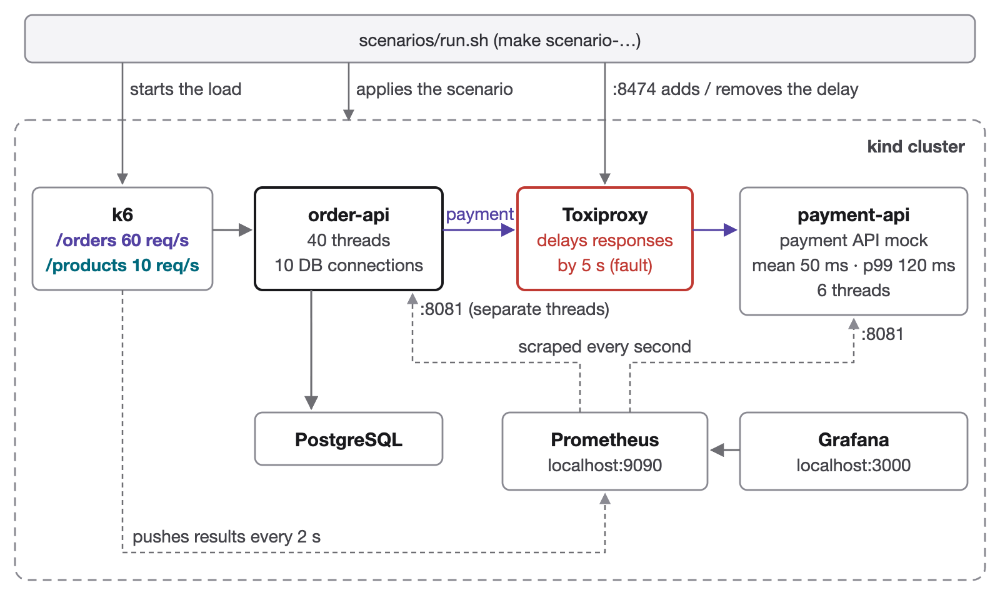
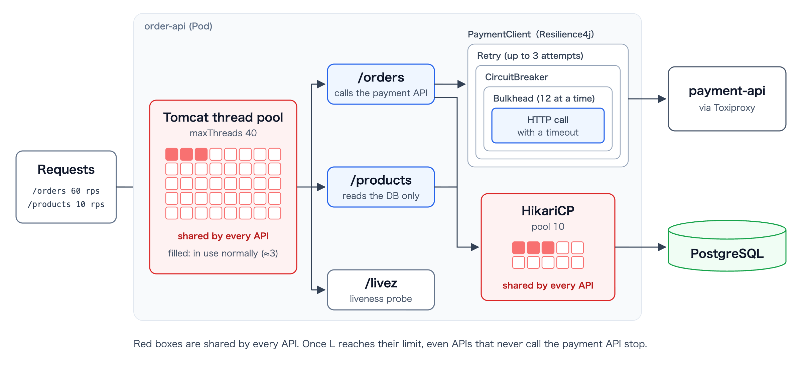
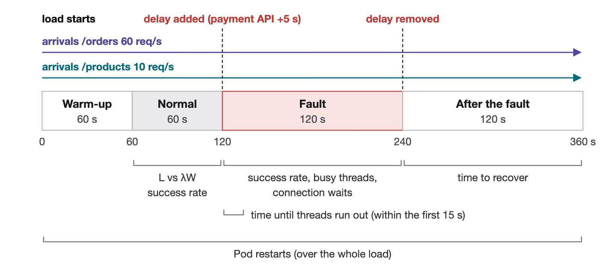

# littles-law-resilience-lab

When the payment API slows down, APIs that never call it stop too. This lab predicts how such a failure spreads with Little's Law (L = λW), reproduces it on a local kind cluster, and checks how timeouts, bulkheads and circuit breakers should be sized.



- **order-api**: Spring Boot (Kotlin), the service under test. `/orders` calls the payment API and stores the order; `/products` only reads the database. 40 Tomcat threads, a HikariCP pool of 10.
- **payment-api**: a payment API mock that answers after a log-normal delay with a given mean and p99. Its six threads cap its throughput at 120 rps.
- **Toxiproxy**: sits between the two and injects latency while the load is running.
- **k6**: sends a constant arrival rate (an open model) and pushes its metrics to Prometheus.



## Requirements

- Docker Desktop with at least 4 GB of memory
- [kind](https://kind.sigs.k8s.io/) and kubectl
- JDK 21 to build the apps
- Node.js and Google Chrome, only to export graphs and diagrams as PNG

Memory limits are tuned so that everything fits on an 8 GB Mac (about 4 GB for Docker).

## Usage

```bash
make up
```

Creates the cluster, builds the apps and deploys everything. Grafana is at http://localhost:3000.

```bash
make scenario-00-no-defense
```

Runs one scenario (about 7 minutes) and writes its damage score to `scenarios/00-no-defense/results/score.json`. Use `make scenarios` to run all of them in order (about an hour).



If `tools/node_modules` exists (`cd tools && npm install`), each run also exports its Grafana panels to `results/panels/`. To export them by hand:

```bash
node tools/capture.mjs scenarios/00-no-defense/results
```

```bash
make down
```

Deletes the cluster.

## Scenarios

| Scenario | What changes | What it shows |
|---|---|---|
| `00-no-defense` | No defense: 30 s timeout, the payment call inside the DB transaction | Threads run out in under a second and `/products` goes down too |
| `01a-timeout` | Timeout cut to 300 ms | Waiting for a DB connection becomes the new W, so it still goes down |
| `01b-tx-boundary` | Payment call moved out of the transaction, 250 ms connection timeout | Threads settle around 60 × 0.3 + α ≈ 20 |
| `02a-no-window` | Payment API p99 raised to 600 ms, timeout 800 ms | With no valid timeout window, threads run out |
| `02b-bulkhead` | Bulkhead: at most 12 concurrent payment calls | Capping L keeps `/products` alive |
| `03a-retry` | Retry: 3 attempts, 500 ms apart | W grows to 1.9 s; in 2 of 4 runs it had still not recovered 2 minutes after the delay was removed |
| `03b-circuit-breaker` | Circuit breaker | Cutting the flow to the payment API brings W close to zero |
| `04-all-defenses` | All of the above | Only `/orders` fails; everything else keeps working |

Results of every scenario are compared in [scenarios/SUMMARY.md](scenarios/SUMMARY.md).

## Documentation (Japanese)

The notes behind the Zenn article are written in Japanese.

- [scenarios/README.md](scenarios/README.md) and `scenarios/<scenario>/prediction.md`: assumptions, predictions and pass criteria written before each run
- [docs/iteration-log.md](docs/iteration-log.md): every place where a prediction missed and how the lab was fixed
- [docs/article-outline.md](docs/article-outline.md): the outline of the article

## Layout

```
apps/order-api/       the service under test
apps/payment-api/     the payment API mock
k8s/base/             apps, database and Toxiproxy (values for "no defense")
k8s/scenarios/        per-scenario differences as kustomize overlays
k8s/observability/    Prometheus and Grafana, dashboard included
loadtest/             k6 script
scenarios/            run script, predictions and results
tools/                panel capture, diagram sources (tools/diagrams) and their renderer
docs/                 iteration log, article outline and diagrams
```

Diagrams are drawn in HTML/SVG under `tools/diagrams/` and exported in Japanese and English with `node tools/render-diagrams.mjs`.

## License

MIT
