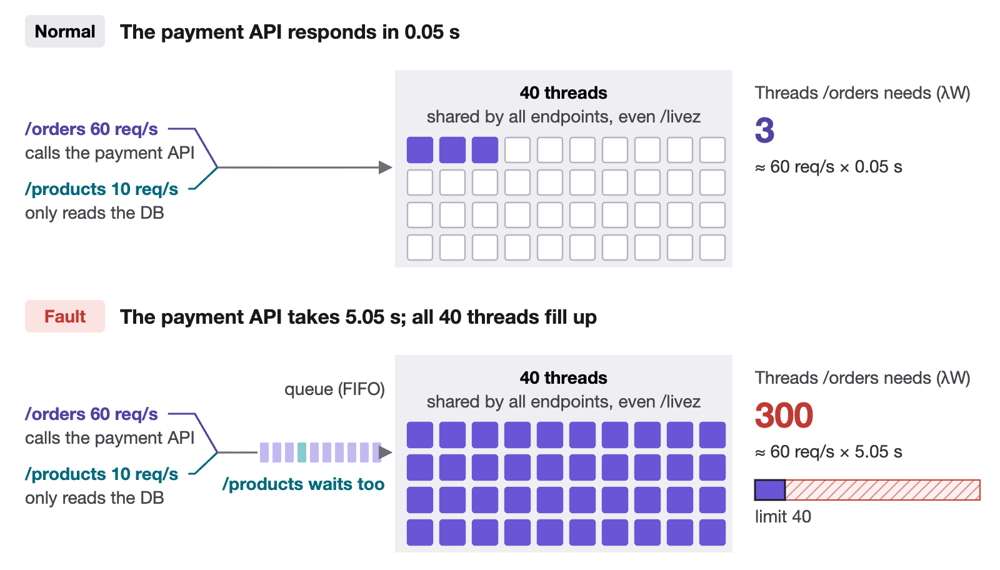
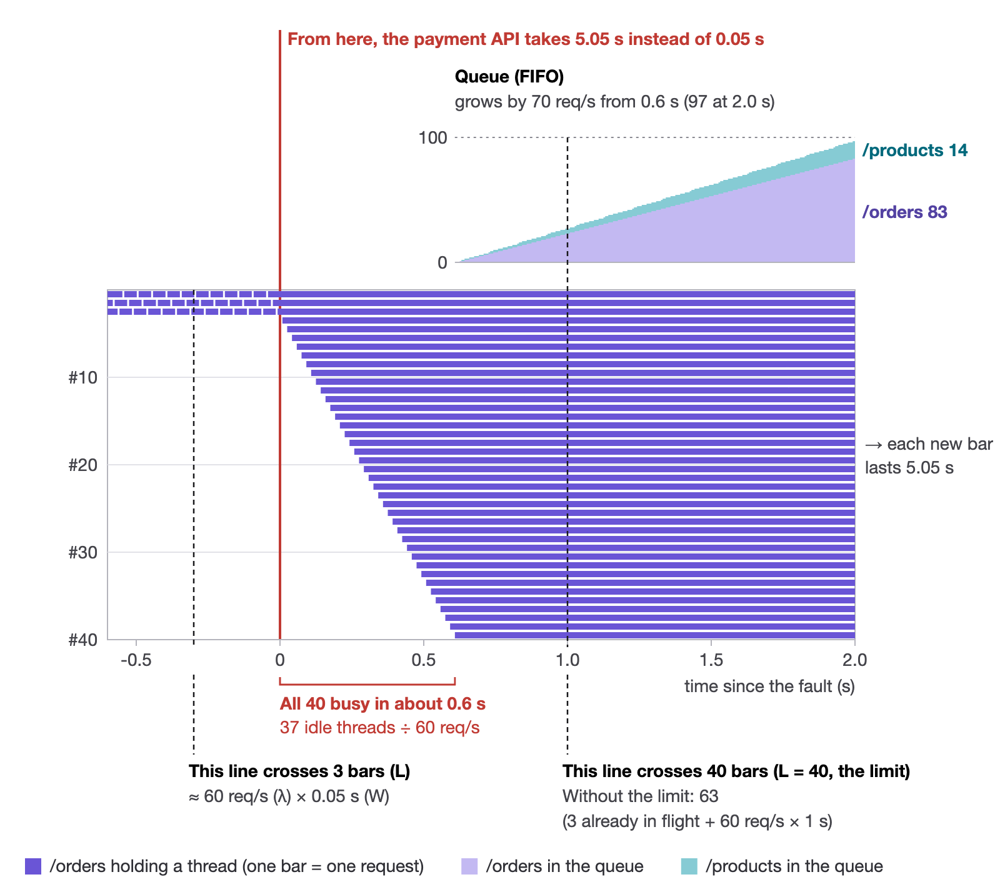
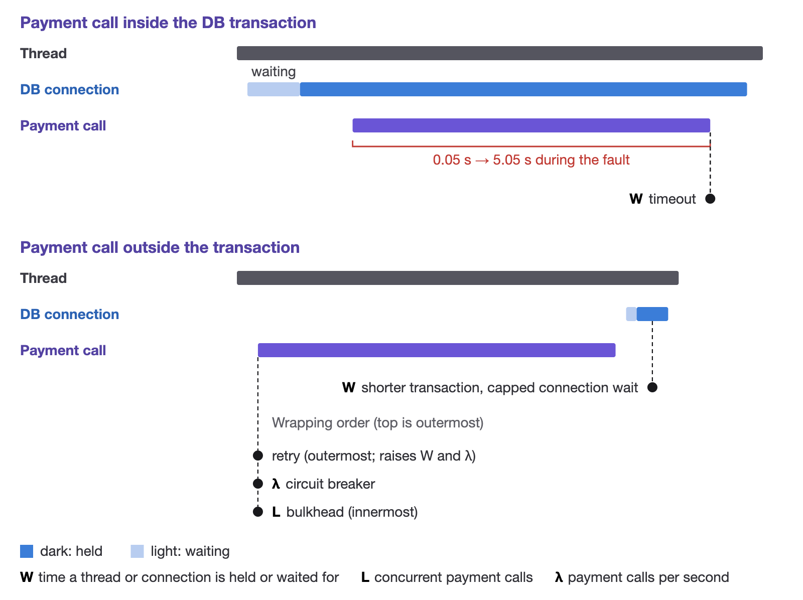

# littles-law-resilience-lab

When a downstream payment API slows down, endpoints that never call it go down too. This lab uses Little's Law (L = λW) to predict how such a failure spreads, reproduces it on a local kind cluster, and checks how timeouts, bulkheads and circuit breakers should be sized.


- **order-api**: Spring Boot (Kotlin), the service under test. `/orders` calls the payment API (inside a DB transaction until scenario 01b moves it out) and stores the order; `/products` only reads the database. Metrics are served on port 8081 by their own threads, so they stay reachable when the 40 request threads run out.
- **payment-api**: a payment API mock that answers after a log-normal delay (mean 0.05 s, p99 0.12 s). Its six threads cap it at about 120 req/s (6 ÷ 0.05 s).
- **Toxiproxy**: sits between the two; `scenarios/run.sh` adds and removes the delay through its admin API.
- **k6**: sends requests at a constant arrival rate (an open model) and pushes its results to Prometheus.

## What goes wrong

With no defenses enabled (scenario `00-no-defense`), every endpoint of order-api shares the same 40 Tomcat threads. Normally the payment API responds in 0.05 s, so by Little's Law `/orders` keeps about 3 threads busy (60 req/s × 0.05 s). When Toxiproxy adds 5 s of latency, `/orders` would eventually need about 300 threads at the same time (60 req/s × 5.05 s). Once all 40 are busy, new requests wait in a single FIFO queue inside Tomcat, regardless of endpoint. Forty threads that each hold a request for 5.05 s can serve at most about 8 req/s (none until the first requests finish at 5 s, and in `00-no-defense` the DB connections cut it to about 2 req/s) against 70 arriving, so the queue only grows. `/products`, which never calls the payment API, sits in that queue until k6 gives up at its own 5 s timeout (a client setting, unrelated to the injected delay). `/livez` is stuck in the same queue, so the liveness probe fails and Kubernetes restarts the Pod.



The 10 DB connections run out too, and sooner than the threads: `/orders` calls the payment API inside a DB transaction, so it holds a connection for the full 5.05 s, and the 7 idle connections (3 are already held by in-flight `/orders`) are gone in about 7 ÷ 60 ≈ 0.12 s. After that, a `/products` request that gets a thread blocks waiting for a connection, so it ties up the thread too.

The 300 is a steady-state figure. Without a limit, in-flight `/orders` requests would grow by 60 per second and reach about 300 only after 5 s; with the limit, busy threads stop at 40 long before that. What matters is how fast the 40 fill up. The chart below is a calculation, not a measurement: each row is a thread and each bar is one `/orders` request. It assumes evenly spaced arrivals and models only the thread pool, not DB connections. How long each bar lasts doesn't matter once it outlasts the fill-up: with 5 s or 30 s of delay, the 40 threads are gone at the same moment.



Prometheus scrapes the busy-thread count once a second, so only the first sample after the fault can land inside the fill-up. In three runs, that sample showed 27 threads busy at 0.34 s, 35 at 0.47 s and all 40 at 0.92 s. The chart counts only `/orders`; adding the `/products` requests that hold a thread while they wait for a DB connection gives 26 at 0.34 s and 34 at 0.47 s, with all 40 busy at about 0.55 s. Both samples taken mid-fill came within one thread of that calculation.

## Requirements

- Docker with at least 4 GB of memory for containers
- [kind](https://kind.sigs.k8s.io/) and kubectl
- JDK 21 to build the apps
- Python 3, used by `scenarios/run.sh` for timestamps and scoring
- Node.js and Google Chrome, only to export graphs and diagrams as PNG

Memory limits are tuned so that everything fits in about 4 GB.

## Usage

```bash
make up
```

Creates the cluster, builds the apps and deploys everything. Grafana is at http://localhost:3000.

```bash
make scenario-00-no-defense
```

Runs one scenario and writes its damage score to `scenarios/00-no-defense/results/score.json`. It takes about 7 minutes: applying the scenario and waiting for the Pods, the 6 minutes of load below, then scoring. Use `make scenarios` to run all of them in order (about an hour).


The score records:

- success rates, busy threads and connection waits during the fault window
- for the normal window, measured L (busy threads) against λW, and the success rates
- how long the threads took to run out, looking at the first 15 s of the fault
- the time to recover: until the start of the first 15-second window in which both endpoints stay at or above 99% success ("not recovered" if no such window starts within the 120 s after the delay is removed)
- the number of Pod restarts during the load

If `tools/node_modules` exists (`cd tools && npm install`), each run also exports its Grafana panels to `results/panels/`. To export them by hand:

```bash
node tools/capture.mjs scenarios/00-no-defense/results
```

```bash
make down
```

Deletes the cluster.

## Scenarios

Each scenario builds on an earlier one (see "What changes") and switches on one or more defenses:

- the timeout and the connection-wait limit cap how long a request waits (W);
- moving the payment call out of the transaction shortens how long it holds a DB connection (W);
- the bulkhead caps how many payment calls run at once (L);
- the circuit breaker stops calls from going out (λ).

The timeout, bulkhead and circuit breaker make `/orders` return sooner, so it also holds its thread for less time. Retries do the opposite and raise both W and λ.



*Schematic of one `/orders` request, not to scale. The upper diagram calls the payment API inside the DB transaction (00, 01a), the lower one outside it (01b on). Each dot marks where a defense acts.*

| Scenario | What changes | What it shows |
|---|---|---|
| `00-no-defense` | No defense: 30 s timeout, the payment call inside the DB transaction | Threads run out in about a second and `/products` goes down too |
| `01a-timeout` | 00 with the payment timeout cut to 300 ms | Connections are still held for the call (60 × 0.3 s = 18 needed against 10), so waiting for one becomes the new W and `/products` still goes down |
| `01b-tx-boundary` | 01a plus: payment call moved out of the transaction, 250 ms connection-wait limit | Threads settle around 20 (60 req/s × the 0.3 s timeout = 18, plus a little) |
| `02a-no-window` | 01b with a slower payment API (mean 100 ms, p99 600 ms, 12 threads) and an 800 ms timeout | No timeout fits between the p99 (0.6 s) and what 40 threads can afford at 60 req/s with 30% headroom (40 × 0.7 ÷ 60 ≈ 0.47 s), so threads run out |
| `02b-bulkhead` | 02a plus a bulkhead: at most 12 concurrent payment calls | Capping L keeps `/products` alive |
| `03a-retry` | 01b plus a retry: 3 attempts, 500 ms apart | W grows to 1.9 s. After the delay is removed, retries push the payment calls up to the payment API's capacity (about 120 req/s); in 1 of 11 runs started on a fresh Pod, order-api had still not recovered 2 minutes later |
| `03b-circuit-breaker` | 03a plus a circuit breaker | Once it opens, cutting the calls to the payment API (λ) makes `/orders` fail fast, so its W drops close to zero |
| `04-all-defenses` | 01b plus a bulkhead, a circuit breaker and a gentler retry (2 attempts, 100 ms apart) | Only `/orders` fails; everything else keeps working |

Results of every scenario are compared in [scenarios/SUMMARY.md](scenarios/SUMMARY.md).

## Documentation (Japanese)

These notes, written in Japanese, are the basis of a companion article on Zenn (a Japanese tech blog platform).

- [scenarios/README.md](scenarios/README.md) and `scenarios/<scenario>/prediction.md`: assumptions, predictions and pass criteria written before each run
- [docs/iteration-log.md](docs/iteration-log.md): every place where a prediction missed and how the lab was fixed
- [docs/article-outline.md](docs/article-outline.md): the outline of the article

## Layout

```
apps/order-api/       the service under test
apps/payment-api/     the payment API mock
k8s/base/             apps, database and Toxiproxy (values for "no defense")
k8s/scenarios/        per-scenario differences as kustomize overlays
k8s/observability/    Prometheus and Grafana, dashboard included
loadtest/             k6 script
scenarios/            run script, predictions and results
tools/                panel capture, diagram sources (tools/diagrams) and their renderer
docs/                 iteration log, article outline and diagrams
```

Diagrams are drawn in HTML/SVG under `tools/diagrams/` and exported in Japanese and English with `node tools/render-diagrams.mjs`.

## License

MIT
