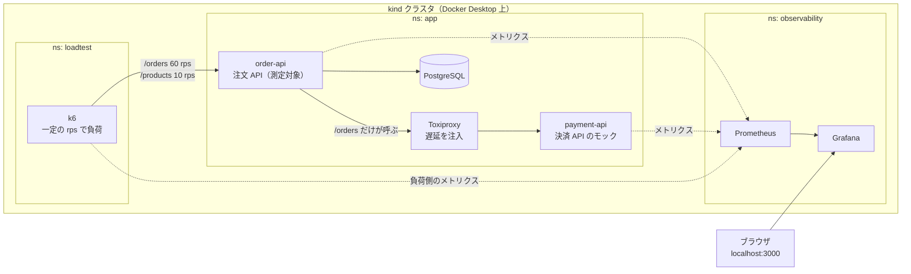

# littles-law-resilience-lab

決済 API が遅くなっただけで、決済と関係のない API まで止まる。その広がり方をリトルの法則（L = λW）で予測し、kind の上で再現して、タイムアウト・バルクヘッド・サーキットブレーカーの決め方を確かめる実験環境です。

## 構成



- **order-api**：Spring Boot（Kotlin）。`/orders` は決済 API を呼んで注文を保存し、`/products` は DB を読むだけ。Tomcat のスレッド 40、HikariCP のプール 10
- **payment-api**：決済 API のモック。平均と p99 を指定した対数正規分布の時間だけ待って返す
- **Toxiproxy**：order-api と payment-api の間に入り、実行中に遅延を注入する
- **k6**：一定の到着率（オープンモデル）で負荷をかけ、結果を Prometheus に送る

## 必要なもの

- Docker Desktop（メモリ 4GB 以上）
- [kind](https://kind.sigs.k8s.io/) と kubectl
- JDK 21（アプリのビルドに使う）
- Node.js と Google Chrome（グラフを PNG に書き出すときだけ）

8GB の Mac（Docker に約 4GB）で動くように、各コンポーネントのメモリ上限を調整しています。

## 動かし方

```bash
make up
```

クラスタの作成、アプリのビルド、デプロイまでを行います。Grafana は http://localhost:3000 で開けます。

```bash
make scenario-00-no-defense
```

1 つのシナリオを実行します（約 7 分）。平常時 → 決済 API に 5 秒の遅延を 2 分間注入 → 解除、の順に進み、被害スコアを `scenarios/00-no-defense/results/score.json` に書き出します。全シナリオを順に回すときは `make scenarios`（約 1 時間）。

```bash
(cd tools/capture && npm install)
node tools/capture/capture.mjs scenarios/00-no-defense/results
```

その回の時間範囲で Grafana のパネルを PNG に書き出します（`results/panels/`）。

```bash
make down
```

クラスタを削除します。

## シナリオ

| シナリオ | 変えること | 確かめること |
|---|---|---|
| `00-no-defense` | 防御なし（タイムアウト 30 秒、決済はトランザクションの中） | 1 秒足らずでスレッドが尽き、`/products` まで止まる |
| `01a-timeout` | タイムアウトを 300ms に | DB コネクションの取得待ちが新しい W になり、やはり止まる |
| `01b-tx-boundary` | 決済をトランザクションの外へ、取得待ちを 250ms に | スレッドは 60 × 0.3 = 18 本で収まる |
| `02a-no-window` | 決済 API の p99 を 600ms に、タイムアウトは 800ms | タイムアウトの窓が存在しないと止まる |
| `02b-bulkhead` | バルクヘッドで決済の呼び出しを同時 12 件まで | L を区切れば `/products` は守られる |
| `03a-retry` | リトライ（3 回試行、間隔 500ms） | W が 1.9 秒に伸び、安全だった設定が崩れる |
| `03b-circuit-breaker` | サーキットブレーカー | 決済への流入を止めると W がほぼ 0 になる |
| `04-all-defenses` | すべての防御 | 被害は `/orders` が失敗を返すことだけで済む |

各シナリオの前提・予測・合格条件は [scenarios/README.md](scenarios/README.md) と `scenarios/<シナリオ>/prediction.md` にあります。作りながら予測とずれたことは [docs/iteration-log.md](docs/iteration-log.md) に残しています。

## ディレクトリ

```
apps/order-api/       注文 API（測定対象）
apps/payment-api/     決済 API のモック
k8s/base/             アプリ・DB・Toxiproxy のマニフェスト（値は「防御なし」）
k8s/scenarios/        シナリオごとの設定の差分（kustomize の overlay）
k8s/observability/    Prometheus と Grafana（ダッシュボード込み）
loadtest/             k6 のスクリプト
scenarios/            実行スクリプト・予測・結果
tools/capture/        Grafana のパネルを PNG に書き出すツール
```

## License

MIT
