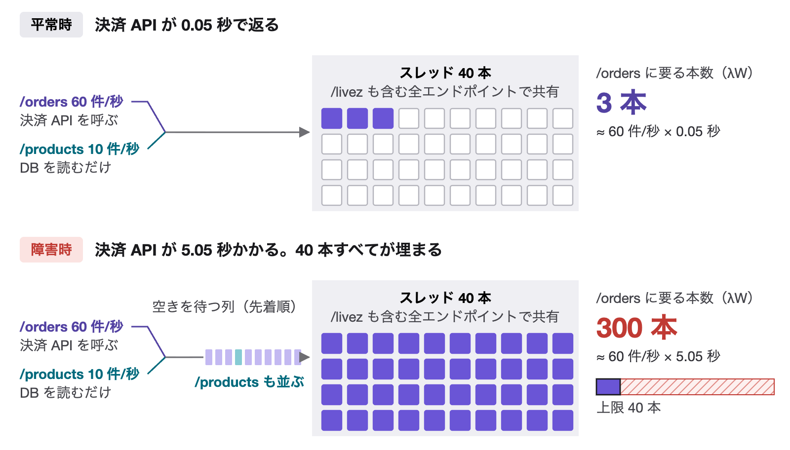
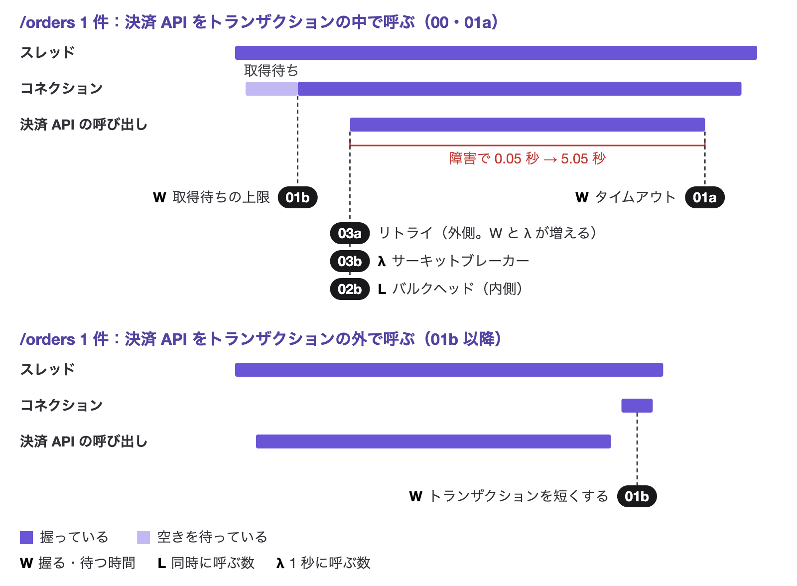
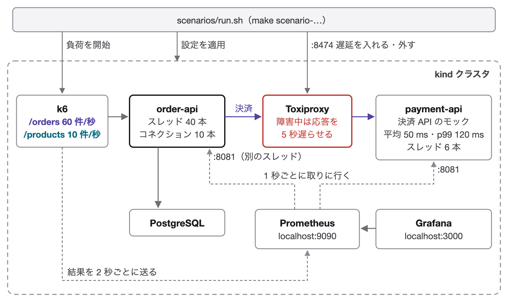
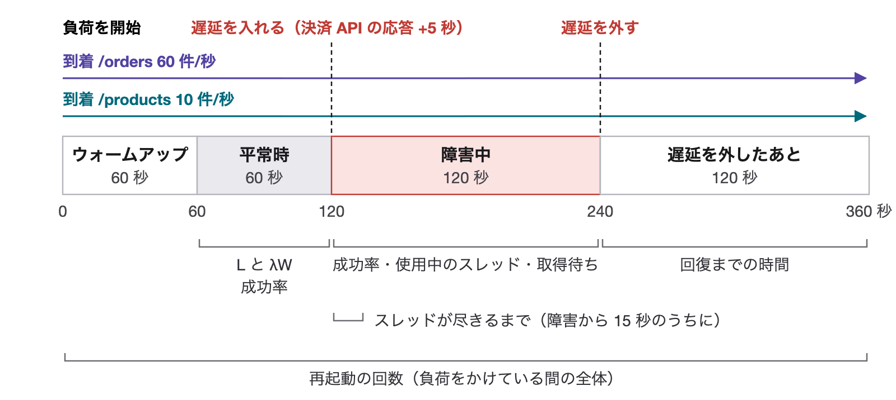
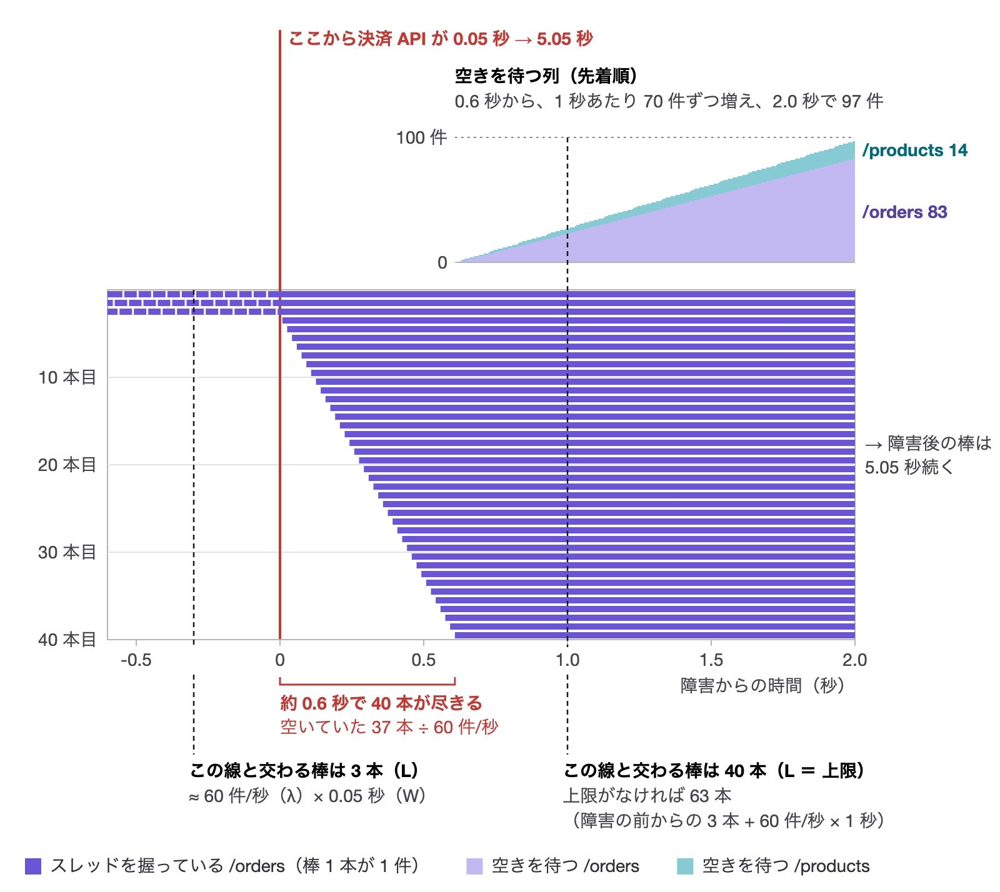
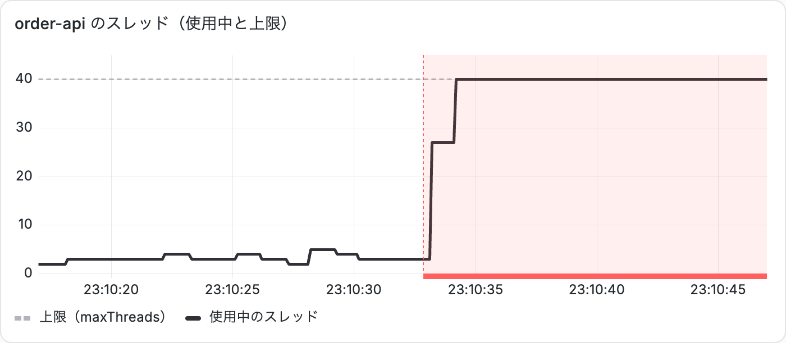
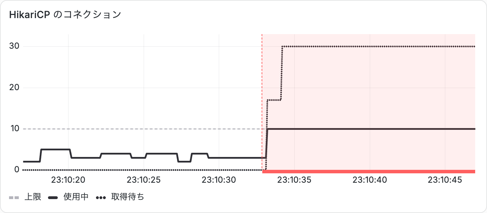

# 記事の本文（書いた節から）

[記事の構成](article-outline.md)のうち、本文を書いた節。図に書くもの（部品の名前、数と式、凡例、切り口の注釈）と、本文に書くもの（前提、結果の流れ、計算や単純化の断り、実測との比べ、次の節への橋渡し）を分けて、図と本文をあわせて読む前提で書いている。図の注記を本文で言い直さず、本文には図から読み取ってほしい解釈と、図の外のこと（タイムアウトのあと、コネクション、実測）を書く。画像のパスは Zenn に移すときに `/images/...` に直す。

---

### 3.2 λW が上限を超えると、共有している資源を通じて広がる

order-api のスレッド 40 本は /orders・/products・/livez のすべてで、HikariCP のコネクション 10 本は /orders と /products で共有しています。この節では、Resilience4j などの防御をまだ何も入れていない状態（5 章の実験 0 と同じ設定）で考えます。

/orders は、決済 API の応答が返るまでスレッドを 1 本握ったままにします。上限がなければ、同時に握る本数は λW で決まります。/products は DB を読むだけで 1 ミリ秒足らずで返るので、スレッドはほとんど使いません。決済 API の応答が 5.05 秒になると、/orders の λW は上限の 40 本を大きく超えます（図の右の列。λW は流れが落ち着いたときの本数で、そこに至るまでの動きは 5.2 で追います）。

*スレッドだけを描いた単純化。コネクションについては下の本文*

40 本がすべて埋まると、あとから来たリクエストは、どのエンドポイント宛てかに関係なく、Tomcat の中の 1 本の列に並んでスレッドの空きを待ちます。負荷をかける k6 は 5 秒でタイムアウトします（決済 API に入れた遅延の 5 秒とは別の設定です）。そのため、次のことが起きます。

- **/products**：決済 API を呼ばないのに、空きを待つうちに 5 秒を過ぎ、ほぼすべて失敗する
- **/orders**：スレッドを取れても 5 秒以内には返らず、失敗する。クライアントがあきらめたあとも処理は続き、スレッドは握られたまま
- **/livez**：応答できず、Kubernetes が Pod を再起動する（実験 0 では障害中に 3 回。5.4）

コネクションでも同じことが起きます。実験 0 では決済 API をトランザクションの中で呼ぶので、/orders はコネクションも 5.05 秒握ります。コネクションの λW も約 300 本です。上限は 10 本とスレッドより少ないので、スレッドより先に尽きます。コネクションが尽きてからスレッドが埋まるまでの短いあいだにスレッドを取れた /products も、コネクションの空きを待ってスレッドを握ります。共有している 2 つの資源がどちらも上限を超えているので、片方だけを増やしても /products は助かりません。6 章では、スレッドとコネクションを握る時間を順に短くします。

遅くなったのは決済 API だけです。それでも、共有している資源を通じて、決済と関係のない API まで止まります。

---

### 3.3 守り方は 3 つ：W を抑える・L を区切る・λ を絞る

L = λW のどれかを小さくすれば、λW を上限の内側に収められます。W は資源を握る・待つ時間、L は同時に呼ぶ数、λ は 1 秒に呼ぶ数です。タイムアウト・バルクヘッド・サーキットブレーカーは決済 API の呼び出しに効き、/orders が早く返るので、スレッドを握る時間も短くなります。取得待ちの上限とトランザクションの範囲は、コネクションに効きます。/orders 1 件が資源を握る時間の入れ子で見ると、防御が効く場所は次のとおりです（札は、それを入れるシナリオの名前）。

*防御の位置は、3 つの資源が入れ子になっている上の段にまとめて描いた（01b 以降は下の段の形で動く）。棒の長さは比例していない*

- **W を短くする**：01a のタイムアウトは決済 API の応答を待つ時間に、01b の取得待ちの上限はコネクションの空きを待つ時間に、上限を付けます。01b では決済 API をトランザクションの外で呼び、コネクションを握るのを、あとの短い書き込みのあいだだけにします（下の段）。スレッドを握る時間は、決済 API の待ちが大半なので、あまり変わりません
- **L を区切る**：02b のバルクヘッドは、決済 API を同時に呼ぶ数を区切ります。あふれた /orders はすぐ断られるので、決済 API を待ってスレッドを握るのは、区切った数までになります
- **λ を絞る**：03b のサーキットブレーカーは、10 秒のあいだに 20 回以上呼んで失敗が半分以上になると開き、5 秒のあいだ決済 API を呼ばずにすぐ失敗を返します
- **リトライ（03a）は逆に働きます**：失敗を取り戻す代わりに、1 件の W と、呼び出しの数 λ を増やします（8 章）

リトライが一番外側にあるので、試行のたびにサーキットブレーカーとバルクヘッドを通り直します。サーキットブレーカーやバルクヘッドに断られた呼び出しは、リトライしません。実験 0 では、どの防御も入れていません。値は次の表のとおりです。

| 守り方 | 手段 | この実験での値 | 入れるシナリオ |
| --- | --- | --- | --- |
| W を抑える | 決済 API のタイムアウト | 30 秒 → 300ms（02a・02b は 800ms） | 01a 以降 |
| W を抑える | コネクションの取得待ちの上限 | 30 秒 → 250ms | 01b 以降 |
| W を抑える | 決済 API をトランザクションの外で呼ぶ | — | 01b 以降 |
| L を区切る | バルクヘッド | 同時に 12 まで。空いていなければ待たずに断る | 02b・04 |
| λ を絞る | サーキットブレーカー | 10 秒の窓で 20 回以上・失敗率 50% で開く。開いたまま 5 秒、半開で 10 回試す | 03b・04 |
| （W と λ が増える） | リトライ | 3 回・500ms おき（04 は 2 回・100ms おき） | 03a・03b・04 |

---

### 4.1 全体の構成

- 負荷も障害も、クラスタの外から scenarios/run.sh が入れます。シナリオの設定を当てると、設定が変わったアプリの Pod だけが入れ替わります（payment-api の設定が変わるのは 02a・02b の前後だけ）
- k6 は到着率を一定に保って送ります（オープンモデル）。応答が遅れても送る数を減らさないので、障害のときに要求が積み上がる様子をそのまま再現できます
- payment-api は 6 本のスレッドで、平均 0.05 秒なら 1 秒に約 120 件までさばけます。リトライで呼び出しが増える 03a で、この上限が効いてきます
- order-api のメトリクスは、業務の 40 本とは別のスレッドで 8081 番から返します。メトリクス用の Service は、readiness に落ちた Pod も返す設定（publishNotReadyAddresses）にしてあるので、40 本が埋まって readiness に落ちても、Prometheus は取りに行けます（5.3）
- 手元の kind クラスタで動くよう、到着率やプールの大きさを本番の約 1/5 に縮めています。比率が同じなら、尽きるまでの秒数は変わりません（付録 B）

### 4.2 1 回の実験の流れ

0 秒の前に、設定の適用と Pod の入れ替え、k6 の起動を待つ時間があり（1 分ほど）、全体では約 7 分かかります。平常時の区間では、測った L と λW が一致すること（2.3）と、平常時の成功率を確かめます。

### 4.3 被害スコア

図の下の括弧が、どの値をどの区間で測るかです。

- **成功率・使用中のスレッド・取得待ち**：障害中の 120 秒で集計する。成功率は区間全体の割合、使用中のスレッドは平均と最大、コネクションの取得待ちの本数は最大
- **スレッドが尽きるまで**：障害から 15 秒のあいだの生の計測で、初めて 40 本になった時刻。計測は 1 秒ごとなので、実際にはこれより早く尽きていることがある。15 秒のうちに 40 本にならなければ「尽きない」
- **回復までの時間**：遅延を外してから、両方のエンドポイントの成功率（直近 6 秒）が 99% 以上になり、そのまま 15 秒続いた区間の始まりまで。120 秒のうちにそうならなければ「戻らない」
- **再起動の回数**：負荷をかけている間の全体で数える。遅延を外したあとに再起動することもある

---

### 5.2 予測：何秒で、どこまで壊れるか

3.2 の 300 本は、上限がなかった場合に、流れが落ち着いたあとの値です。障害の直後にスレッドがどう埋まるかは、1 件ずつの動きを追うと分かります。到着を等間隔にし、スレッドだけを数えて計算したのが次の図です。

図の 1 行が 1 本のスレッドです。縦に切ったときに交わる棒の数が、その瞬間に使っているスレッドの数 L になります。障害の前は、0.05 秒の短い棒が上の 3 行を入れ替わりで使っています（/products は 1 ミリ秒足らずで返るので、棒は描いていません）。

*計算（実測ではない）*

- **埋まるまでの時間は、空いている本数と到着率で決まる。** 障害の時点で処理中だった 3 件も応答が遅れるので、空いているのは 37 本です。終わる棒がないまま 1 秒に 60 本ずつ増えるので、約 0.6 秒で埋まります。棒が十分に長ければ、5 秒でも 30 秒でも同じです（どこまで短くすれば埋まらないかは、6.1 で求めます）
- **上限がなくても、300 本にはすぐにはならない。** 1.0 秒の時点では 63 本です。300 本で落ち着くのは、最初の棒が終わり始め、増える棒と終わる棒が釣り合う 5 秒後からです

**L = λW の λ は、その資源に実際に入る率です。** 2 章では λ を到着率と呼びましたが、上限で頭打ちのあいだ、スレッドに入れる率は到着率よりずっと小さくなります。0.6〜5 秒は 1 件も入れません。5 秒後からは、終わった棒の数だけ入れ替わりに入るので、平均で 40 ÷ 5.05 ≈ 8 件/秒です。落ち着けば 40 本 = 8 件/秒 × 5.05 秒で成り立ちます。入れなかった残りは列に並び、伸び続けます（図の上の「空きを待つ列」）。上限がなければ入る率は到着率と同じなので、3.2 の 60 件/秒 × 5.05 秒 ≈ 300 本になります。

予測は「障害から約 0.6 秒で 40 本が埋まり、/products は列に並んで 5 秒でタイムアウトする」です。

:::details 実験 0 では、コネクションの分だけ少し早い（約 0.55 秒）
実験 0 では決済 API をトランザクションの中で呼ぶので、コネクション 10 本が先に (10 − 3) ÷ 60 ≈ 0.12 秒で尽きます。このとき使っているスレッドは、コネクションを握った /orders の 10 本です。そのあとは /products もコネクションの空きを待つあいだ（HikariCP の取得待ちの上限は 30 秒）スレッドを握るので、残りの 30 本は 1 秒に 70 本ずつ埋まり、0.12 + 30 ÷ 70 ≈ 0.55 秒で満杯になります。
:::

### 5.3 実測：5 秒を待たずに、1 秒ほどで 40 本が埋まる

計測は 1 秒ごとです（計測は業務とは別のポートで受けているので、40 本が埋まっても測れます）。予測の約 0.6 秒は計測の間隔より短いので、障害の直後の 1〜2 点で確かめます。障害の時刻をミリ秒で記録した 2 回の実行を比べます。

*2 回目の実行。赤い帯が障害の区間*

2 回目の実行では、障害の 0.48 秒後の最初の計測で、40 本すべてが埋まっていました。1 回目は、0.40 秒後に 24 本、次の 1.40 秒後の計測で 40 本でした。どちらも、決済 API の遅れの 5 秒を待たずに、1 秒ほどで埋まっています。計算（約 0.6 秒で満杯）に対して、2 回目は早く、1 回目は少し遅れています。1 秒ごとの計測では、これ以上細かくは比べられません（ずれの理由は下の折りたたみ）。

*2 回目の実行。黒が使用中、灰色が取得待ち、破線が上限*

障害のあとは、どの計測でもコネクションは 10 本とも使われていて、握っている 10 本と待っている本数を足すと、スレッドの本数に一致しました（2 回目の 0.48 秒は 10 + 30 = 40、1 回目の 0.40 秒は 10 + 14 = 24）。1 回目の 0.40 秒の時点で、コネクションはもう尽きていたことになります。取得待ちが 30 で止まっているのは、スレッドが 40 本で頭打ちだからです（コネクションを待てるのは、スレッドを持っているリクエストだけ）。障害の前も約 3 本使っているのは、決済 API をトランザクションの中で呼んでいるからで、60 件/秒 × 0.05 秒と合います。/products が 5 秒でタイムアウトしたことは、5.4 の成功率で確かめます。

:::details 計算とのずれの理由
コネクションの分を入れた計算（5.2 の折りたたみ）では、0.40 秒で 30 本、0.48 秒で 35 本です（処理中だった 3 本 + /orders の 60 件/秒 × 経過時間 + /products の 10 件/秒 ×（経過時間 − コネクションが尽きる 0.12 秒））。2 回の実行の生の値は scenarios/00-no-defense/results/runs.md にあります。1 回目はこれより 6 本少なく、2 回目は少なくとも 5 本多くなっています（2 回目は 40 本で頭打ちなので）。

- **2 回目が多い理由**：2 つ考えられます。1 つは障害を入れた時刻の記録の遅れです。時刻は、遅延を入れる API の応答が返ってから、別のプロセスを起動して取っています。応答が返るまでと、起動にかかる時間（測ると 15〜20 ミリ秒）の分だけ記録が遅れ、経過時間は数十ミリ秒短く出ます（1〜3 本ぶん）。もう 1 つは、障害の時点で処理中だった本数です。平常時の本数は計測ごとにぶれ（障害の前の 1 分間で 1〜8 本）、3 本より多かった可能性があります
- **1 回目が少ない理由**：k6 が障害の直後に送りきれなかったためと考えています。k6 は、応答を待っているリクエスト 1 件に 1 VU を使い、空いた VU がなければ、その回を捨てて VU を作り足します。障害の前に用意してあった VU は、2 つのシナリオの合計で 1 回目が 17、2 回目が 43 でした（作った VU は残るので、それまでの経過で実行ごとに数が違います）。1 回目は、/orders に使える VU が多くて 12（/products に最初から 5 割り当てるため）で、空いていた分が障害から 0.15 秒ほどで尽きました。そのあとは VU を作り足す速さ（1 秒に約 30）でしか送れていないので、0.15〜0.40 秒の 0.25 秒で、計算より 7 本ほど少なくなります。2 回目は、満杯になる 0.5 秒ごろまで、用意してあった VU で足りていました。なお、障害から 2 秒ほどのあいだに送れなかった /orders の件数は、1 回目が 54 件、2 回目が 43 件で、2 回目の分は満杯のあとに出たはずです
:::

---

## README の該当部分（英語）

README の構成図の後、「Requirements」の前に置く。

> ## What goes wrong
>
> With no defenses enabled (scenario `00-no-defense`), every endpoint of order-api shares the same 40 Tomcat threads. Normally the payment API responds in 0.05 s, so by Little's Law `/orders` keeps about 3 threads busy (60 req/s × 0.05 s). When Toxiproxy adds 5 s of latency, `/orders` would eventually need about 300 threads at the same time (60 req/s × 5.05 s). Once all 40 are busy, new requests wait in a single FIFO queue inside Tomcat, regardless of endpoint. Forty threads that each hold a request for 5.05 s can serve only about 8 req/s against 70 arriving, so the queue only grows. `/products`, which never calls the payment API, sits in that queue until k6 gives up at its own 5 s timeout (a client setting, unrelated to the injected delay). `/livez` is stuck in the same queue, so the liveness probe fails and Kubernetes restarts the Pod.
>
> 
>
> The 10 DB connections run out too, and sooner than the threads: `/orders` calls the payment API inside a DB transaction, so it holds a connection for the full 5.05 s, and the 7 idle connections are gone in about 7 ÷ 60 ≈ 0.12 s. After that, a `/products` request that gets a thread blocks waiting for a connection, so it ties up the thread too.
>
> The 300 is a steady-state figure. Without a limit, in-flight `/orders` requests would grow by 60 per second and reach about 300 only after 5 s; with the limit, busy threads stop at 40 long before that. What matters is how fast the 40 fill up. The chart below is a calculation, not a measurement: each row is a thread and each bar is one `/orders` request. It assumes evenly spaced arrivals and models only the thread pool, not DB connections. How long each bar lasts doesn't matter once it outlasts the fill-up: with 5 s or 30 s of delay, the 40 threads are gone at the same moment.
>
> 
>
> Prometheus scrapes the busy-thread count once a second. In one run, the first sample after the fault, 0.48 s in, already showed all 40 busy. In another run, 24 were busy at 0.40 s and all 40 at the next sample, 1.40 s in. The two runs land on either side of the estimate; once-a-second sampling can't resolve it more finely than that.
